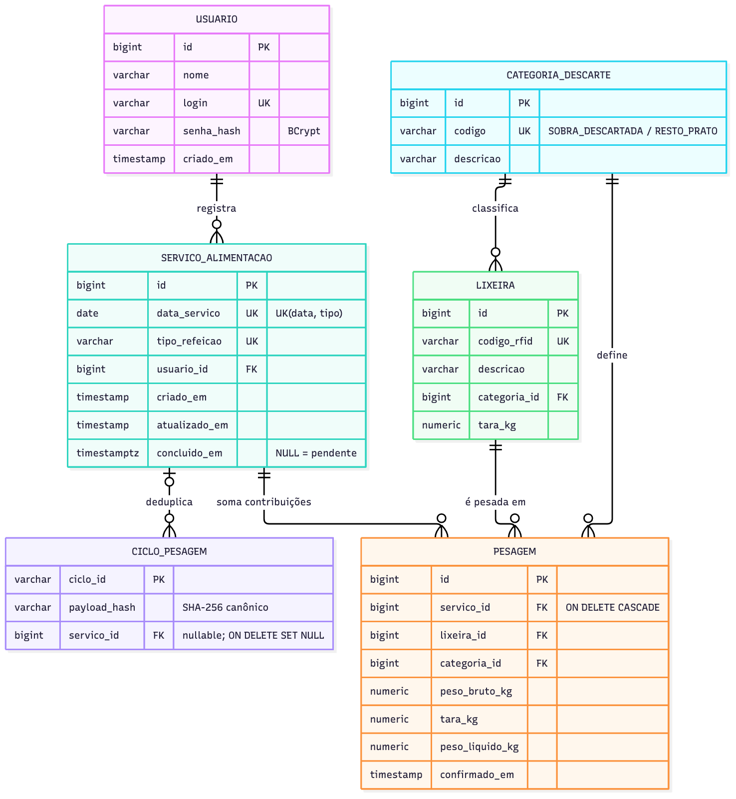

# Banco de dados

PostgreSQL 14+; validado com PostgreSQL 16.4. Seis entidades normalizadas: `usuario`, `categoria_descarte`, `lixeira`, `servico_alimentacao`, `pesagem` e `ciclo_pesagem`.

| Arquivo | Finalidade |
| --- | --- |
| `01_schema.sql` | Criação em banco vazio; sem `DROP TABLE`. Falha se já houver esquema. |
| `02_carga_inicial.sql` | Somente operador BCrypt, duas categorias e duas lixeiras. Nenhum serviço/pesagem. |
| `03_consultas.sql` | Sete consultas com JOIN e agregações. |
| `04_fixture_opcional.sql` | Histórico fictício opcional, separado da inicialização automática. Somente demonstração em banco vazio de serviços. |
| `migrations/001_integracao.sql` | Migração transacional do esquema original, sem apagar dados. |
| `der.mmd` / `der.png` | DER editável e renderizado com PK, FK e cardinalidades. |
| `evidencias/` | Testes SQL e saídas reais da execução isolada. |

## Executar em banco novo

```sh
cd database
docker compose up -d
# Porta 55439; ajustar MERENDA_DB_PORT caso esteja ocupada.
docker compose exec -T postgres psql -U merenda -d merenda -v ON_ERROR_STOP=1 < 03_consultas.sql
docker compose exec -T postgres psql -U merenda -d merenda -v ON_ERROR_STOP=1 < evidencias/testes-constraints.sql
# Somente quando desejar histórico fictício para demonstração:
docker compose exec -T postgres psql -U merenda -d merenda -v ON_ERROR_STOP=1 < 04_fixture_opcional.sql
```

O Compose usa nome de projeto próprio, porta alternativa e volume dedicado. Scripts 01/02 executam apenas no primeiro início do volume vazio. Não executar `down -v` sobre dados que se deseja preservar. Para PostgreSQL já provisionado, executar 01 e 02 com `psql -v ON_ERROR_STOP=1 -f`, apontando explicitamente para um banco novo.

Credenciais públicas da aplicação: **operador / merenda123**. A carga guarda apenas o hash BCrypt. `ck_usuario_hash` verifica o formato básico; a API verifica a senha com BCrypt. Credenciais PostgreSQL locais no Compose: merenda/merenda; não são credenciais de produção.

## Modelo e regras



| Relacionamento | Cardinalidade | Regra |
| --- | --- | --- |
| usuário → serviço | 1 : 0..N | Operador responsável pelo serviço |
| categoria → lixeira | 1 : 0..N | Categoria fixa da lixeira |
| serviço → pesagem | 1 : 0..N | Contribuições individuais; várias da mesma categoria são permitidas |
| lixeira/categoria → pesagem | 1 : 0..N | FK composta assegura categoria coerente com a lixeira |
| serviço → ciclo | 0..1 : 0..N | Chave global persistida identifica cada confirmação/correção |

O índice único `uk_servico_data_tipo_normalizado` protege data/refeição com normalização de caixa, acentos portugueses usuais e espaços; aceita refeições além de almoço/jantar. A API também normaliza o texto antes de gravar. A unicidade original exata permanece como proteção adicional.

`concluido_em` nulo significa pendente. A presença das duas categorias permite solicitar conclusão, mas não a executa automaticamente. Zero confirmado é registro; ausência permanece nula nas consultas. As consultas analíticas consideram apenas serviços explicitamente concluídos. A consulta 2 soma contribuições por serviço/categoria antes de calcular a média; a 3 divide o total pelo número de serviços concluídos, nunca pelo número de pesagens. A consulta 4 é um ranking, sem alerta de limite.

`ciclo_pesagem` guarda `ciclo_id` global e hash SHA-256 do pedido canônico. A transação da API compara o hash: replay idêntico não grava; conteúdo diferente conflita. Correções também geram ciclos e alteram apenas a contribuição selecionada. Exclusão do serviço remove contribuições por cascade; preserva ciclo e hash com `servico_id` nulo (`ON DELETE SET NULL`). Um retry após exclusão continua identificado e a API retorna conflito `SERVICO_EXCLUIDO`, sem recriar o serviço. Esse registro mínimo garante idempotência, sem histórico de versões. A conclusão persiste durante correções.

O banco protege PK/FK, normalização/unicidade, tara não negativa, bruto entre tara e 500 kg e líquido igual a bruto menos tara. Regras de dia/fuso America/Sao_Paulo, conclusão com ambas as categorias, mesma lixeira na correção, bloqueio de novas contribuições após conclusão e comparação do hash são verificadas transacionalmente na API; os testes SQL de constraints não substituem esses testes de comportamento. A precisão armazenada é de três casas; a API rejeita precisão maior antes da coerção de `NUMERIC`.

## Migrar uma instalação antiga

Não executar 01 em banco existente. Fazer backup e testar sua restauração em ambiente separado. Revisar nomes/versão do esquema e executar a migração em uma transação, com `ON_ERROR_STOP=1`. O script remove somente a constraint que impedia contribuições individuais; não apaga tabelas, serviços ou pesagens. Se houver refeições equivalentes após normalização, o índice falha e a transação deve ser revertida: revisar os registros manualmente, sem mesclagem automática. O script é de aplicação única.

A migração deixa `concluido_em` nulo para todo legado: o esquema antigo não guardava a decisão explícita, portanto contagem de categorias não é evidência de conclusão. Não cria ciclos retroativos nem importa AsyncStorage. A alteração pode bloquear escrita durante sua execução; programar a aplicação conforme o ambiente real.

## Evidência executada

Em 17/11/2026 foram executados schema/carga, onze verificações de constraints, fixture e sete consultas em PostgreSQL **16.4 real isolado**, além da migração sobre cópia do esquema/carga originais. Docker não estava disponível (link para app ausente); foi usado o binário redistribuível Zonky `embedded-postgres-binaries-darwin-arm64v8:16.4.0` em `/private/tmp/merenda-pg-isolado`, sem instalação global ou acesso a banco preexistente. Conexão somente `127.0.0.1:55439`, usuário local `merenda`; autenticação trust restrita ao ambiente temporário. Driver `psycopg2-binary` em venv temporário.

- `execucao-merenda.txt`: banco novo com zero serviços após carga mínima.
- `execucao-merenda_validacao.txt` / `execucao-scripts.txt`: onze casos SQL e sete resultados de consultas sobre fixture opcional.
- `migracao.txt`: 11 registros e soma preservados; nenhuma conclusão inferida; contribuição adicional aceita; colisão normalizada aborta e reverte o esquema.
- `analitico.txt`: média correta por serviço 2,280 kg difere de 1,900 kg por pesagem, com várias contribuições.
- `testes-constraints.sql`: executável novamente por psql; transação revertida ao final.

A execução do Compose não foi comprovada nesta máquina. O PostgreSQL temporário foi deixado ativo para testes integrados do executor principal; encerrar depois com `/private/tmp/merenda-pg-isolado/binarios/bin/pg_ctl -D /private/tmp/merenda-pg-isolado/dados stop`. Estes logs comprovam SQL/constraints, não o runtime mobile nem todo comportamento da API.
